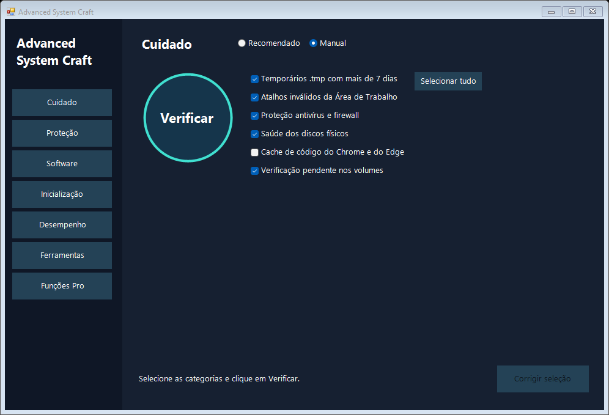
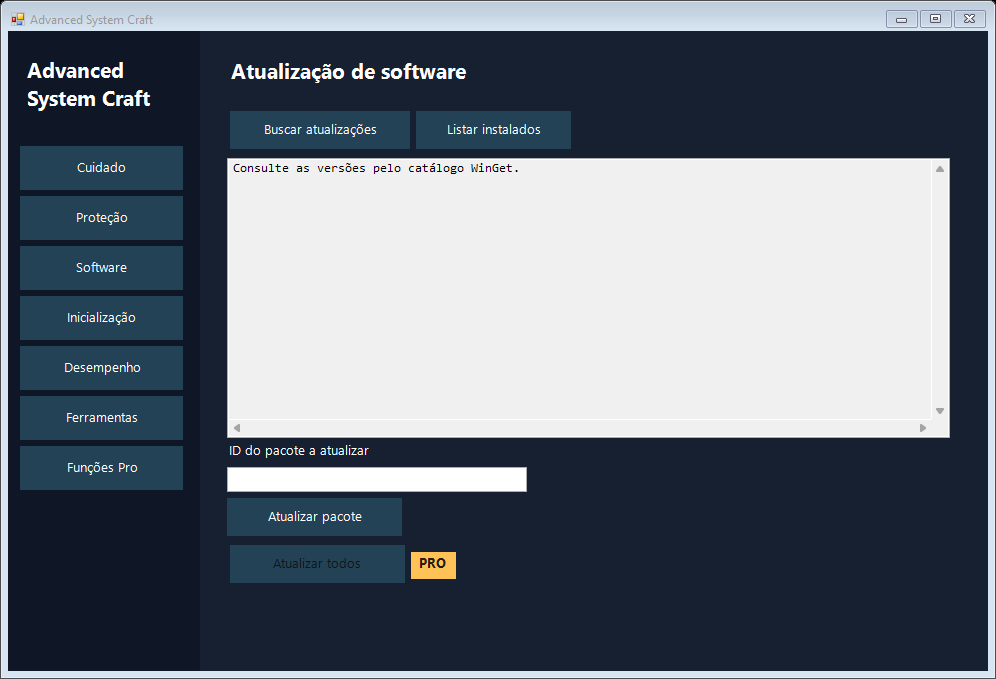

# Advanced System Craft

Aplicativo independente de manutenção para Windows em português. Selecione as categorias, execute uma verificação e revise os arquivos antes de enviá-los à Lixeira. A versão 0.3.0 usa o Windows para o diagnóstico local e o catálogo WinGet para consultas de software, sem instalação, anúncios ou telemetria.

**[Baixar para Windows](https://github.com/recalchi/AdvancedSystemCraft/releases/tag/v0.3.0)**

| Área | Funções desta versão |
| --- | --- |
| Cuidado | Verifica arquivos .tmp com mais de sete dias na raiz da pasta temporária do usuário e atalhos .lnk com destino ausente em disco local na raiz da Área de Trabalho. |
| Privacidade | Identifica entradas de cache de código nos perfis Default e Profile N de Chrome e Edge fechados. A seleção é opcional. |
| Proteção e hardware | Consulta o firewall por perfil, o antivírus registrado, o estado dos discos físicos e o sinalizador de verificação pendente dos volumes. |
| Software | Consulta o catálogo WinGet. Exibe as versões reportadas e permite abrir o instalador interativo para um ID exato. Após consultar as atualizações, o botão Atualizar todos permite iniciar um lote interativo. |
| Cuidado recomendado | Seleciona verificações de arquivos e de saúde e inclui o cache dos navegadores quando a unidade do perfil tem menos de 10% de espaço disponível. O usuário revisa os itens antes de corrigir. |
| Correção | Mostra caminho e tamanho, revalida cada item selecionado e usa a Lixeira do Windows. Falhas aparecem na lista. |
| Inicialização | Lista entradas das chaves Run e das pastas de inicialização do usuário e do computador. Abre as configurações do Windows para gerenciamento. |
| Desempenho | Atualiza CPU, RAM e os oito processos com maior memória residente a cada dois segundos enquanto a tela está aberta. Mostra também a capacidade e o espaço livre dos discos fixos. |
| Ferramentas | Abre o Monitor de Recursos, o Gerenciador de Tarefas e as configurações de inicialização. |

## O selo PRO

O selo dourado identifica um recurso pago no produto de referência e incluído no Craft. Em **Software**, clique em **Buscar atualizações** para obter a prévia do WinGet e habilitar **Atualizar todos**. A tela **Funções Pro** distingue os equivalentes disponíveis dos recursos ainda pendentes.

## Executar a partir do código

No Windows com o .NET Framework 4.x e seu compilador C# de 64 bits, abra o PowerShell na pasta do projeto.

~~~powershell
.\build.ps1
.\test.ps1
& '.\build\v0.3.0\Advanced System Craft.exe'
~~~

O teste cria amostras próprias, verifica a correção de um atalho descartável e percorre a interface. As pastas reais do usuário são apenas examinadas no teste.

O fluxo de cuidado manual tem como referência a documentação pública do Advanced SystemCare. A tabela acima descreve a cobertura atual da implementação. [Manual do produto de referência](https://www.iobit.com/product-manuals/asc-help/)
